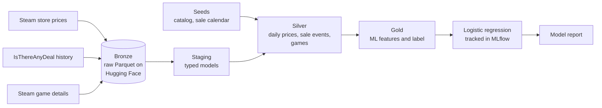

# Should I Wait for the Sale?

**A study project: an end-to-end data pipeline that predicts whether a Steam game will go on sale in Brazil within the next 30 days.**


PC game prices in Brazil have climbed past R$ 400. Steam notifies you once a sale has started, and price tools focus mostly on history, alerts, and sale calendars. This project explores the question a buyer has **before** paying: *buy now, or wait?*

I built it to gain hands-on experience in my field with something I enjoy outside of work: playing games. It covers both data engineering and data science, from raw API responses to an evaluated model. It is a non-commercial learning project, not a replacement for existing tools: similar ideas exist, and the focus here is the method.

## Highlights

| | |
|---|---|
| **Model** | 79.1% accuracy on full-price games, against 60.7% for the seasonal baseline and 66.7% for always answering "yes" |
| **Probability quality** | Brier score of 0.144, against 0.204 for the calibrated baseline |
| **Harder test** | 73.6% accuracy on 137 games the model never saw in training |
| **Data** | 500 games, 666k+ daily prices since 2019, 13,230 sale events |
| **Quality** | 78 dbt build items and 48 pytest tests, running in CI on every push |
| **Cost** | $0 in infrastructure |

## Project status

| Phase | Deliverable | Status |
|---|---|---|
| 0. Feasibility | Scripts validating every data source | Done |
| 1. Daily collection | Scheduled collector writing to the bronze layer | Running, awaiting 7 consecutive scheduled runs |
| 2. Silver and gold | dbt project with tests | Done |
| 3. History | Price history merged into the daily table | Done |
| 4. Model | Features, baseline, logistic regression, report | Done |
| 5. Predictions and scoreboard | Daily append-only predictions and aggregate hit rate | Planned |
| 6. App | Local Streamlit app with 3 screens | Planned |

This is a study project: the app is meant to run locally, and neither an app nor the collected data will be published. Only the code and aggregate results are public. The first scoreboard result can only exist 30 days after daily predictions begin, because each forecast needs its full window to be checked.

## Objectives

1. Tell a buyer the probability that a game goes on sale within 30 days, along with its typical discount.
2. Run a reliable, automated pipeline for Brazilian prices at no cost.
3. Prove model quality instead of claiming it, by comparing it with simple rules and reporting the result either way.

## Benefits

- **For the buying decision:** an estimate made before paying, instead of finding out about a sale after the purchase.
- **For trust:** results are measured against simple rules on data the model never saw, including where it falls short.
- **For engineers reading this:** a compact, fully visible example of a tested data pipeline, with every decision written down.

## Scope

**In scope for V1**
- Brazil only, in BRL.
- A catalog of 500 games: paid top sellers in the Brazilian store, plus my own wishlist.
- A 30-day sale prediction, a baseline, and an aggregate scoreboard.
- A local Streamlit app with three screens: wishlist, unusually low prices, and scoreboard.

**Possible future work:** recommendations and region comparisons.

**Out of scope:** a public app, publishing the collected data, automatic purchases, push notifications, and stores other than Steam.

## Architecture



GitHub Actions schedules the daily collection and runs tests and dbt on every push. dbt builds and tests the transformations, with DuckDB as the query engine. The history and game details are one-off local loads, and training also runs locally.

**Why this stack:** it is free, fully visible on GitHub, and made of tools widely used in the industry. With hundreds of games and one row per day, Spark would add cost without adding value, so leaving it out was a deliberate choice.

## Results

Evaluated on 149,388 full-price rows from 2025-01-31 to 2026-10-05, with training data up to 2024-12-31.

| Approach | Accuracy | Precision | Recall | F1 | Brier | ROC AUC |
|---|---|---|---|---|---|---|
| Always "yes" | 0.667 | 0.667 | 1.000 | 0.800 | 0.333 | 0.500 |
| Seasonal baseline | 0.607 | 0.850 | 0.498 | 0.628 | 0.393 | 0.661 |
| Seasonal baseline, calibrated | 0.607 | 0.850 | 0.498 | 0.628 | 0.204 | 0.661 |
| **Logistic regression** | **0.791** | **0.801** | **0.913** | **0.854** | **0.144** | **0.852** |

The full analysis, including calibration, is in the [model report](docs/model_report.md) (in Portuguese).

### How the evaluation avoids misleading numbers

- **Time-based split:** the model trains on the past and is tested on later months, never on a random split.
- **30-day gap:** the label looks 30 days ahead, so training and test periods are separated by that same window.
- **No data from the future:** features use only information available on each row's date. Unit tests with hand-calculated values enforce this.
- **Full-price focus:** a game already on sale usually stays on sale tomorrow, which would inflate the metrics.
- **A tougher comparison:** the planned baseline scored below always answering "yes", so the model is measured against both.
- **Leakage check:** with shuffled labels, ROC AUC averaged 0.516 across 6 seeds, consistent with chance.

### Known limitations

- The catalog comes from today's top sellers, so the model only knows games that are still relevant. Performance on an arbitrary game is likely lower.
- For games with no previous sale, there is little history to learn from: ROC AUC drops to 0.642.
- The model overestimates probabilities between 10% and 40%.
- Full prices from the history source differ from Steam by more than 5% for 20 of 484 games on the merge date. This affects price features, not the sale label.

## What the data taught me

The project started with feasibility tests, and several findings changed the plan:

- **Steam batch requests have no fixed limit.** Some batches of 186 games returned HTTP 500 while others of 213 succeeded, with no pattern in size or URL length. The collector uses batches of 50 and splits a batch in half when it fails.
- **Old BRL history is noisy.** Before 2019, full prices shifted slightly at almost every record, which suggests currency conversion. Small changes dropped from 147 in December 2018 to 4 in January 2019, so the model only uses data from 2019 onward.
- **The data validates itself.** All 15 published seasonal sale dates from 2023 to 2026 matched the peaks and end dates found independently in the sale events table.

## Stakeholders

| Group | Interest |
|---|---|
| PC gamers in Brazil, the reference user | Knowing whether to buy now or wait |
| Recruiters and hiring teams | Evidence of practical data skills |
| Me, as the author | Hands-on experience across the data lifecycle |

## Deliverables and reporting

| Deliverable | Status |
|---|---|
| Automated daily collection | Running |
| Tested dbt project | Done |
| Trained model tracked in MLflow | Done, stored locally |
| [Model vs. baseline report](docs/model_report.md) | Done |
| [Feasibility findings](spikes/FINDINGS.md) | Done |
| [Design document and decision log](docs/design.md) | Maintained throughout the project |
| Aggregate scoreboard, comparing model and baseline over time | Planned |
| Local Streamlit app | Planned |

## Budget

Infrastructure cost is **$0**, using free tiers of GitHub Actions and Hugging Face, and free API access. The only investment is my own time.

## Timeline

| Milestone | Date |
|---|---|
| Phases 0 to 4 completed | 2026-11-04 |
| First scheduled collection | 2026-11-05 |
| Earliest end of the 7-day collection check | 2026-11-11 |
| Predictions and scoreboard | Next phase |
| First resolved prediction | 30 days after predictions begin |

## Engineering practices

- **Collectors do not transform data.** Raw responses go to the bronze layer with metadata, and all transformation happens in dbt.
- **Idempotent writes:** rerunning a day overwrites that day's partition and never duplicates it.
- **Reliability:** rate limiting, backoff on HTTP 429, and one failed game never stops a run.
- **Quality checks:** uniqueness, valid price ranges, a minimum daily volume, and alerts for missing days.
- **Traceability:** every significant decision is recorded in the [design document](docs/design.md).

## Running it locally

Requires Python 3.12, a Hugging Face dataset, and these environment variables. Locally, the collectors read them from a `.env` file; dbt needs them exported in the shell.

```text
HF_TOKEN, HF_DATASET_REPO, ITAD_API_KEY, STEAM_API_KEY, STEAM_ID
```

```bash
python -m venv venv
source venv/bin/activate        # Windows: venv\Scripts\activate
pip install -r requirements.txt

python -m pytest                          # tests
python -m ingestion.steam_prices          # daily collection
cd dbt && dbt build --profiles-dir . && cd ..
python -m ml.train                        # train and write the report
```

## Project structure

```text
ingestion/   Python collectors, one module per source
dbt/         Models (staging, silver, gold), seeds, and tests
ml/          Dataset, evaluation, training, and report
spikes/      Feasibility tests and findings
tests/       pytest suite
docs/        Design document and model report
```

## Credits

**Data sources**
- Price history provided by the [IsThereAnyDeal](https://isthereanydeal.com) API.
- Store prices, game details, wishlist, and library data come from Steam.

**Open source tools:** [dbt Core](https://github.com/dbt-labs/dbt-core) and [dbt-duckdb](https://github.com/duckdb/dbt-duckdb) (Apache-2.0), [DuckDB](https://github.com/duckdb/duckdb) (MIT), [scikit-learn](https://github.com/scikit-learn/scikit-learn) (BSD-3-Clause), [MLflow](https://github.com/mlflow/mlflow) (Apache-2.0), [Apache Arrow](https://github.com/apache/arrow) (Apache-2.0), [huggingface_hub](https://github.com/huggingface/huggingface_hub) (Apache-2.0), and [pytest](https://github.com/pytest-dev/pytest) (MIT).

**AI assistance:** developed with [Claude Code](https://claude.com/claude-code) as a pair programmer.

**Disclaimer:** this is an independent portfolio project. It is not affiliated with, endorsed by, or sponsored by Valve, Steam, or IsThereAnyDeal. Steam and the Steam logo are trademarks of Valve Corporation. Predictions are estimates and do not guarantee future prices. The collected data stays in a private dataset and is not redistributed.

## Contact

[LinkedIn: linkedin.com/in/lucasgiazzi](https://www.linkedin.com/in/lucasgiazzi)
